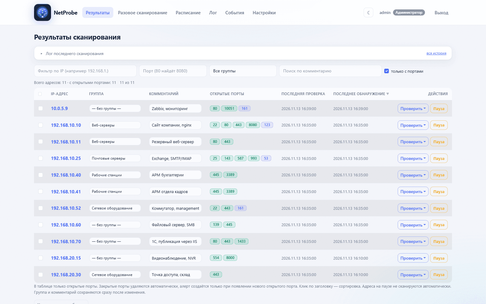
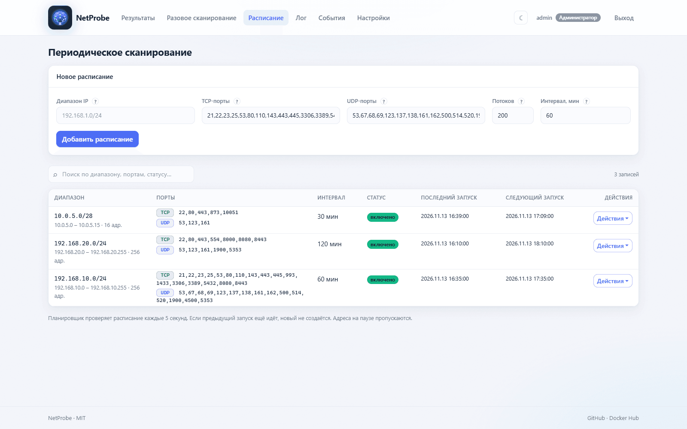
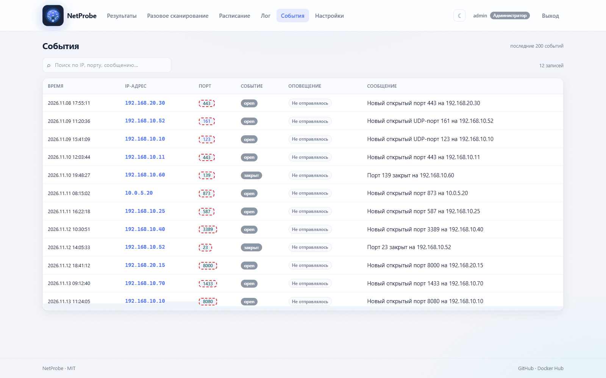
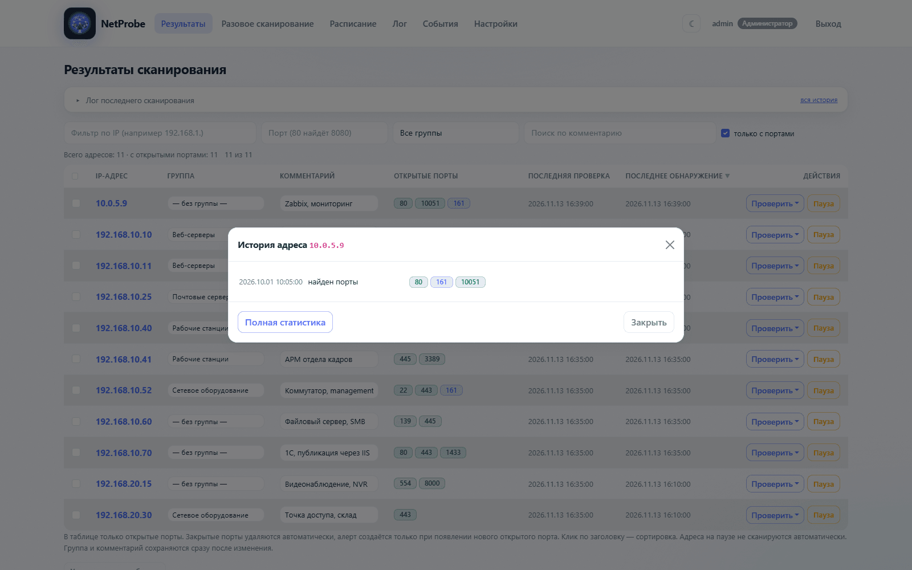
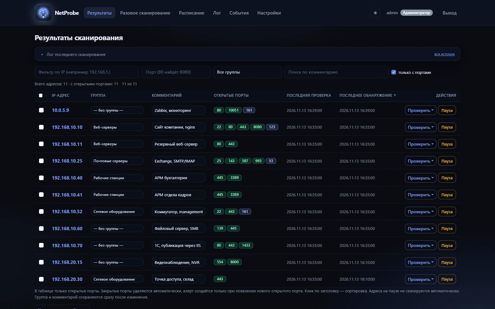
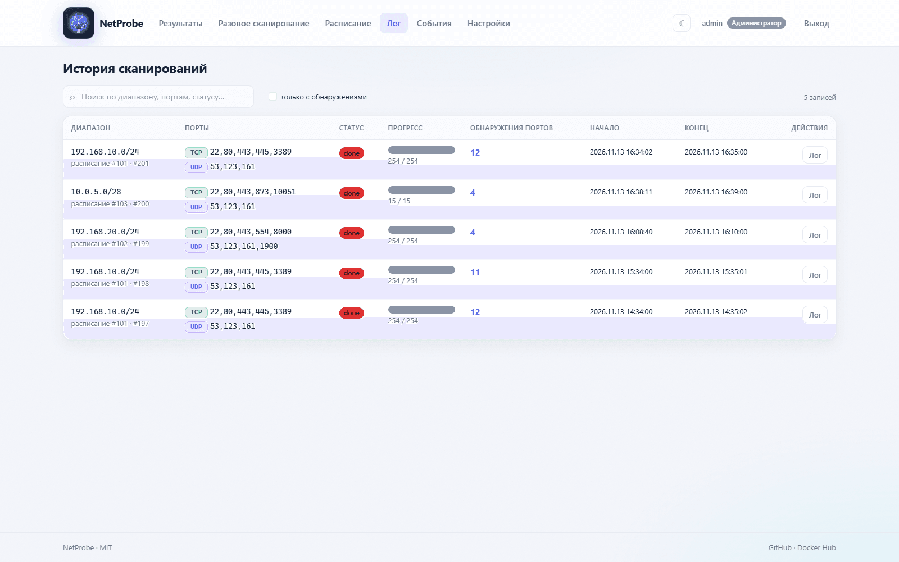
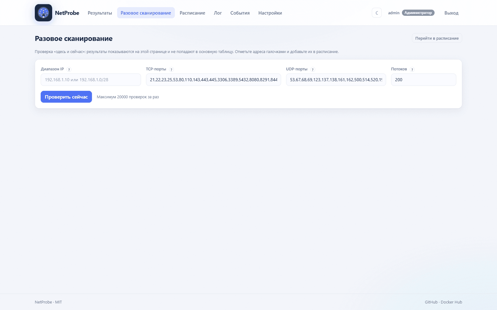

# NetProbe

Мониторинг открытых портов в веб-интерфейсе: сканирование TCP и UDP, расписание
проверок, история изменений и уведомления в Telegram, MAX, E-mail, Zabbix и Syslog.

Приложение отвечает на вопрос «что изменилось в сети»: показывает только адреса
из расписания, подсвечивает новые и закрытые порты и присылает сообщение, когда
порт открылся или закрылся. Запускается одним контейнером, база — SQLite внутри тома.

[](https://hub.docker.com/r/ruiiru/netprobe)
[](https://hub.docker.com/r/ruiiru/netprobe/tags)
[](https://hub.docker.com/r/ruiiru/netprobe/tags)
[](https://www.python.org/)
[](LICENSE)

- **Docker Hub:** [ruiiru/netprobe](https://hub.docker.com/r/ruiiru/netprobe)
- **Исходный код:** [github.com/ratnikov-d/NetProbe](https://github.com/ratnikov-d/NetProbe)
- **Интерфейс:** русский, темы светлая и тёмная



## Скриншоты

| Расписание | События |
|---|---|
|  |  |
| **История адреса** | **Тёмная тема** |
|  |  |
| **Лог сканирований** | **Разовое сканирование** |
|  |  |

> Скриншоты сняты на демонстрационных данных: адреса и комментарии вымышлены.

## Содержание

- [Быстрый старт](#быстрый-старт)
- [Первый вход](#первый-вход)
- [Роли и доступ](#роли-и-доступ)
- [Как это работает](#как-это-работает)
- [Переменные окружения](#переменные-окружения)
- [Данные и резервные копии](#данные-и-резервные-копии)
- [Обновление](#обновление)
- [HTTPS через Traefik](#https-через-traefik)
- [Сборка из исходников](#сборка-из-исходников)
- [Ограничения](#ограничения)
- [API](#api)
- [Структура проекта](#структура-проекта)
- [Безопасность](#безопасность)
- [Лицензия](#лицензия)

## Быстрый старт

Нужен только Docker. Образ готов для `linux/amd64`, `linux/arm64` и `linux/arm/v7`.

### 1. Docker Compose (рекомендуется)

```yaml
# docker-compose.yml
services:
  netprobe:
    image: ruiiru/netprobe:latest
    container_name: netprobe
    ports:
      - "5000:5000"
    environment:
      - SECRET_KEY=change-me-in-production
      - TZ=Europe/Moscow
    volumes:
      - netprobe_data:/app/data
    restart: unless-stopped

volumes:
  netprobe_data:
```

```bash
docker compose up -d
```

### 2. Docker CLI

```bash
docker run -d --name netprobe \
  -p 5000:5000 \
  -e SECRET_KEY=change-me-in-production \
  -e TZ=Europe/Moscow \
  -v netprobe_data:/app/data \
  --restart unless-stopped \
  ruiiru/netprobe:latest
```

Откройте <http://localhost:5000>.

Порт по умолчанию — **5000**. Меняется левой частью проброса: `-p 8080:5000`
(внутри контейнера приложение всегда слушает 5000).

## Первый вход

| Логин | Пароль |
|---|---|
| `admin` | `admin123` |

Пароль по умолчанию создаётся только при пустой базе — **смените его сразу**
в «Настройки → Пользователи». Дальше добавьте расписание: «Расписание → Добавить»,
адрес или подсеть, порты TCP и UDP, интервал. Первое сканирование запускается
сразу после сохранения.

## Роли и доступ

| Роль | Права |
|---|---|
| Администратор | всё, включая пользователей и роли |
| Специалист ИБ | всё, кроме раздела «Пользователи» |
| Пользователь | просмотр разделов и проверка одного IP |

Встроенные роли можно дополнить своими: «Настройки → Пользователи → Роли»,
права включаются переключателями. Пароли хранятся как PBKDF2-хеши.

## Как это работает

- **Расписание** — периодический мониторинг адресов, диапазонов и подсетей.
  Планировщик живёт внутри контейнера: остановили контейнер — автосканы не идут.
- **Результаты** — только адреса из расписаний; убрали расписание — ушли и строки.
- **События** — открытие и закрытие портов. Закрытый порт обведён пунктирной рамкой;
  уведомление приходит на **новый** порт (первый скан адреса уведомлений не создаёт).
- **Перепроверка** — «молчащие» порты проверяются повторно с большим таймаутом,
  ранее открытый порт — ещё тщательнее, чтобы фильтры и rate-limit не давали
  ложных «закрыт». UDP проверяется настоящим запросом протокола (DNS, NTP, SNMP,
  NetBIOS, SSDP, mDNS, TFTP).
- **Разовое сканирование** — `/quick`, результат на странице и в базу не пишется.

Уведомления настраиваются в «Настройки → Оповещения»: канал, типы событий
(открытие / закрытие) и язык сообщений. Кнопка «Проверить» отправляет тестовое
сообщение.

## Переменные окружения

| Переменная | По умолчанию | Описание |
|---|---|---|
| `SECRET_KEY` | `change-me-in-production` | ключ сессий и CSRF, задайте свой |
| `TZ` | `Europe/Moscow` | часовой пояс контейнера |
| `DB_NAME` | `/app/data/port_scanner.db` | путь к SQLite |
| `APP_PORT` | `5000` | внешний порт (только `docker-compose.yml` из репозитория) |
| `SCAN_WORKERS` | `200` | потоков сканирования по умолчанию |
| `SOCKET_TIMEOUT` | `1.2` | таймаут TCP-проверки, сек |
| `PROBE_RETRIES` | `1` | повторов, если порт не ответил |
| `PROBE_RETRY_DELAY` | `0.2` | пауза между повторами, сек |
| `TCP_CONFIRM_ROUNDS` | `2` | кругов перепроверки молчащих портов |
| `TCP_CONFIRM_TIMEOUT` | `2.5` | таймаут перепроверки, сек |
| `TCP_CONFIRM_DELAY` | `1.0` | пауза между кругами, сек |
| `TCP_CONFIRM_WORKERS` | `100` | потоков в перепроверке |
| `CLOSE_CONFIRM` | `2` | промахов подряд до закрытия порта |
| `TCP_CLOSE_ROUNDS` | `3` | кругов проверки ранее открытого TCP-порта |
| `UDP_CLOSE_ATTEMPTS` | `3` | попыток для ранее открытого UDP-порта |
| `UDP_TIMEOUT` | `0.6` | ожидание ответа UDP, сек |
| `UDP_DNS_TIMEOUT` | `1.5` | ожидание ответа DNS (UDP/53), сек |
| `UDP_RETRIES` | `2` | попыток UDP-проверки |
| `UDP_RETRY_DELAY` | `0.2` | пауза между попытками UDP, сек |
| `UDP_ENABLED` | `1` | `0` — отключить UDP-проверки |
| `CHUNK_SIZE` | `2000` | проверок в одной пачке |
| `SCHED_TICK` | `5` | период опроса расписания, сек |
| `QUICK_MAX_CHECKS` | `20000` | максимум проверок за разовое сканирование |

Токены Telegram, MAX, SMTP, Zabbix и Syslog в переменных окружения **не хранятся**:
они задаются в интерфейсе и лежат в базе, в таблице `settings`.

## Данные и резервные копии

Всё состояние — файл SQLite `/app/data/port_scanner.db` в томе `netprobe_data`.
Схема создаётся при старте, новые колонки добавляются автоматически: миграции
запускать не нужно.

```bash
# бэкап
docker cp netprobe:/app/data/port_scanner.db ./port_scanner-$(date +%F).db

# восстановление
docker cp ./port_scanner-2026-11-13.db netprobe:/app/data/port_scanner.db
docker restart netprobe
```

## Обновление

```bash
docker pull ruiiru/netprobe:latest
docker compose up -d          # или: docker restart netprobe
```

Теги образа: `latest` и короткий хеш коммита (`8998d6d`). Для воспроизводимых
установок фиксируйте хеш вместо `latest`.

## HTTPS через Traefik

Внешний reverse-proxy не входит в поставку: контейнер слушает HTTP на 5000, TLS
и домен настраиваются на стороне Traefik. Минимальный набор меток:

```yaml
services:
  netprobe:
    image: ruiiru/netprobe:latest
    container_name: netprobe-web
    restart: unless-stopped
    environment:
      - SECRET_KEY=${SECRET_KEY}
      - TZ=${TZ:-Europe/Moscow}
    volumes:
      - netprobe_data:/app/data
    networks: [traefik]
    labels:
      - "traefik.enable=true"
      - "traefik.docker.network=${TRAEFIK_NETWORK}"
      - "traefik.http.routers.netprobe.rule=Host(`${NETPROBE_DOMAIN}`)"
      - "traefik.http.routers.netprobe.entrypoints=websecure"
      - "traefik.http.routers.netprobe.tls.certresolver=letsencrypt"
      - "traefik.http.services.netprobe.loadbalancer.server.port=5000"

volumes:
  netprobe_data:

networks:
  traefik:
    external: true
    name: ${TRAEFIK_NETWORK}
```

Сеть должна быть создана заранее (`docker network create <имя>`), Traefik — настроен
на тот же certresolver.

## Сборка из исходников

```bash
git clone https://github.com/ratnikov-d/NetProbe.git
cd NetProbe
cp .env.example .env
docker compose up -d --build
```

Без Docker:

```bash
python -m venv .venv && . .venv/bin/activate   # Windows: .venv\Scripts\activate
pip install -r requirements.txt
python app.py
```

Мультиархитектурная сборка:

```bash
docker buildx build --platform linux/amd64,linux/arm64,linux/arm/v7 \
  -t ruiiru/netprobe:latest --push .
```

## Ограничения

- Диапазон — до 4096 адресов (маска не меньше `/20`), до 2000 портов в списке.
- Разовое сканирование — до 20000 проверок за запуск (`QUICK_MAX_CHECKS`).
- UDP подтверждается только тем, что отвечает на запросы: службы вроде Syslog/514
  и DHCP/67 по broadcast остаются «закрытыми».
- Планировщик работает в процессе приложения: без запущенного контейнера
  расписание не выполняется.
- Встроенной аутентификации достаточно для внутренней сети; наружу выставляйте
  через reverse-proxy с HTTPS.

## API

Веб-интерфейс использует те же эндпоинты, что доступны извне (нужна сессия):

| Метод | Путь | Назначение |
|---|---|---|
| `POST` | `/api/scan` | запуск: `{ip_range, ports, udp_ports, workers}` |
| `POST` | `/api/scan/stop` | остановка: `{log_id}` |
| `GET` | `/api/scan/progress` | прогресс последнего задания |
| `GET` | `/api/scan/events?log_id=&after=` | события задания |
| `GET` | `/api/alerts` | события (алерты) |
| `GET` | `/api/quick/status/<job_id>` | прогресс разового сканирования |
| `POST` | `/api/host/meta` | группа и комментарий адреса: `{ip, group_id, comment}` |
| `POST` | `/api/hosts/bulk` | массовые действия: `{action: group\|pause\|resume\|scan, ips, group_id}` |
| `POST` | `/api/ports/purge` | убрать порт из результатов: `{port, update_schedules}` |
| `POST` | `/api/groups` | создать группу: `{name}` |
| `POST` | `/api/groups/<id>/rename` | переименовать группу: `{name}` |
| `DELETE` | `/api/groups/<id>` | удалить группу |

## Структура проекта

```
netprobe/
├── app.py                      # Flask: сканирование, планировщик, API
├── static/                     # style.css, app.js, table.js, logo.svg
├── templates/                  # Jinja2: layout, dashboard, quick, schedules, logs, alerts, settings, users
├── docs/screenshots/           # скриншоты для README
├── Dockerfile
├── docker-compose.yml
├── .env.example
├── requirements.txt
├── LICENSE
└── README.md
```

## Безопасность

- Смените `SECRET_KEY` и пароль `admin` до первого запуска в сети.
- Сканируйте только те адреса, на которые у вас есть разрешение: приложение
  само разрешений не проверяет.
- Контейнер слушает 5000 без TLS — для внешнего доступа используйте Traefik,
  Nginx или Caddy.

## Лицензия

[MIT](LICENSE) © NetProbe contributors
