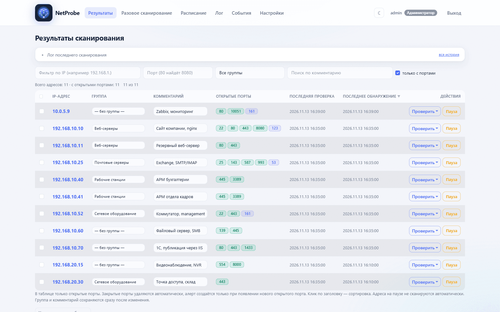

# NetProbe

Мониторинг открытых портов: сканирование TCP и UDP по расписанию, история
изменений, уведомления в Telegram, MAX, E-mail, Zabbix и Syslog.
Один контейнер, база SQLite внутри тома, интерфейс на русском.

Исходный код и полная документация: <https://github.com/ratnikov-d/NetProbe>



Тёмная тема: <https://raw.githubusercontent.com/ratnikov-d/NetProbe/main/docs/screenshots/07-dashboard-dark.png>

## Платформы

`linux/amd64`, `linux/arm64`, `linux/arm/v7` (Raspberry Pi).

## Быстрый старт

```bash
docker run -d --name netprobe \
  -p 5000:5000 \
  -e SECRET_KEY=change-me-in-production \
  -e TZ=Europe/Moscow \
  -v netprobe_data:/app/data \
  --restart unless-stopped \
  ruiiru/netprobe:latest
```

Интерфейс: <http://localhost:5000>

Compose:

```yaml
services:
  netprobe:
    image: ruiiru/netprobe:latest
    container_name: netprobe
    ports:
      - "5000:5000"
    environment:
      - SECRET_KEY=change-me-in-production
      - TZ=Europe/Moscow
    volumes:
      - netprobe_data:/app/data
    restart: unless-stopped

volumes:
  netprobe_data:
```

## Первый вход

| Логин | Пароль |
|---|---|
| `admin` | `admin123` |

Создаётся только при пустой базе. Смените пароль в «Настройки → Пользователи».

## Что внутри

- Расписание: адреса, диапазоны и подсети (до 4096 адресов, маска не меньше `/20`).
- TCP и UDP отдельными списками портов, до 2000 портов в списке.
- Повторная проверка «молчащих» портов, чтобы фильтры и rate-limit не давали
  ложных «закрыт»; UDP подтверждается настоящим запросом протокола
  (DNS, NTP, SNMP, NetBIOS, SSDP, mDNS, TFTP).
- События открытия и закрытия портов, история по каждому адресу.
- Группы адресов, комментарии, массовые действия, пауза по адресу.
- Роли: администратор, специалист ИБ, пользователь + собственные роли.
- Тёмная и светлая темы, русский интерфейс.

## Порт и том

| Что | Значение |
|---|---|
| Порт приложения | `5000` (меняется пробросом `-p 8080:5000`) |
| База | `/app/data/port_scanner.db` |
| Том | `/app/data` |

## Переменные окружения

| Переменная | По умолчанию | Описание |
|---|---|---|
| `SECRET_KEY` | `change-me-in-production` | ключ сессий и CSRF — задайте свой |
| `TZ` | `Europe/Moscow` | часовой пояс |
| `DB_NAME` | `/app/data/port_scanner.db` | путь к SQLite |
| `SCAN_WORKERS` | `200` | потоков сканирования |
| `SOCKET_TIMEOUT` | `1.2` | таймаут TCP-проверки, сек |
| `TCP_CONFIRM_ROUNDS` | `2` | кругов перепроверки молчащих портов |
| `TCP_CONFIRM_TIMEOUT` | `2.5` | таймаут перепроверки, сек |
| `CLOSE_CONFIRM` | `2` | промахов подряд до закрытия порта |
| `UDP_ENABLED` | `1` | `0` — отключить UDP-проверки |
| `QUICK_MAX_CHECKS` | `20000` | максимум проверок за разовое сканирование |

Полный список — в README на GitHub. Токены Telegram, MAX, SMTP, Zabbix и Syslog
задаются в интерфейсе и хранятся в базе, а не в переменных окружения.

## Теги

- `latest` — последняя сборка ветки `main`.
- Короткий хеш коммита (`8998d6d`) — воспроизводимая версия.

## Обновление

```bash
docker pull ruiiru/netprobe:latest
docker compose up -d
```

Схема базы обновляется при старте автоматически, миграции не нужны. Перед
обновлением сделайте бэкап:

```bash
docker cp netprobe:/app/data/port_scanner.db ./port_scanner-backup.db
```

## Лицензия

MIT. Сканируйте только те адреса, на которые у вас есть разрешение.
